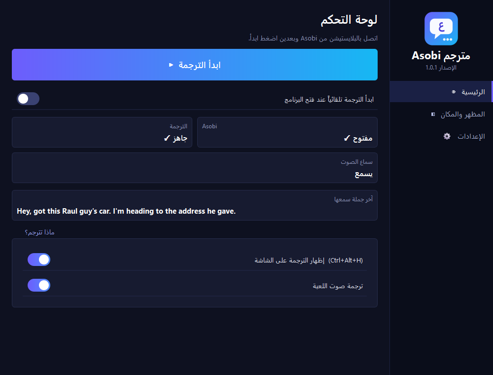
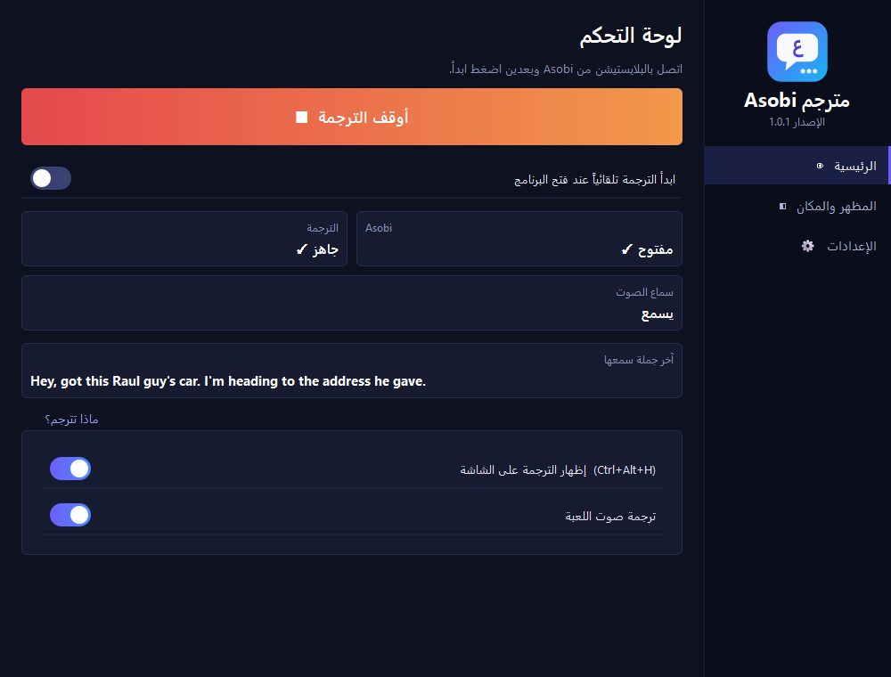
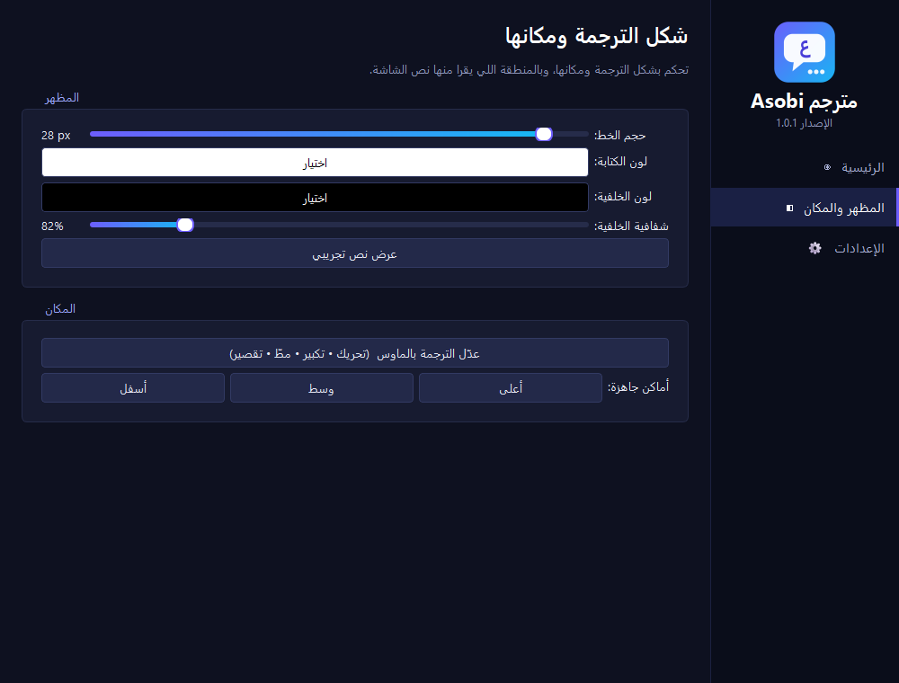
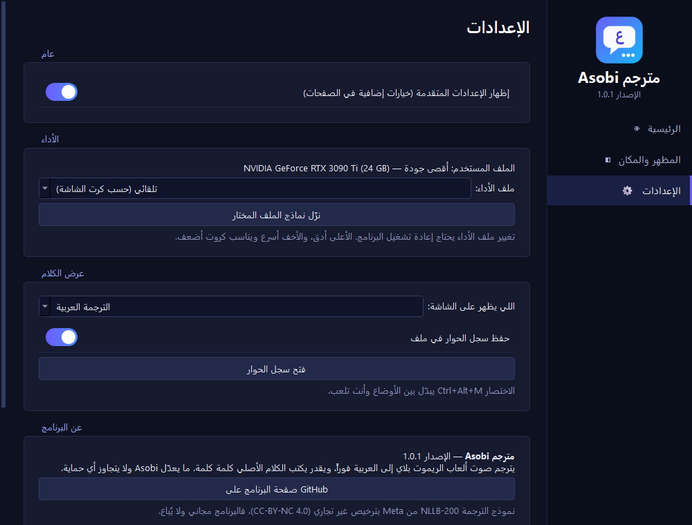
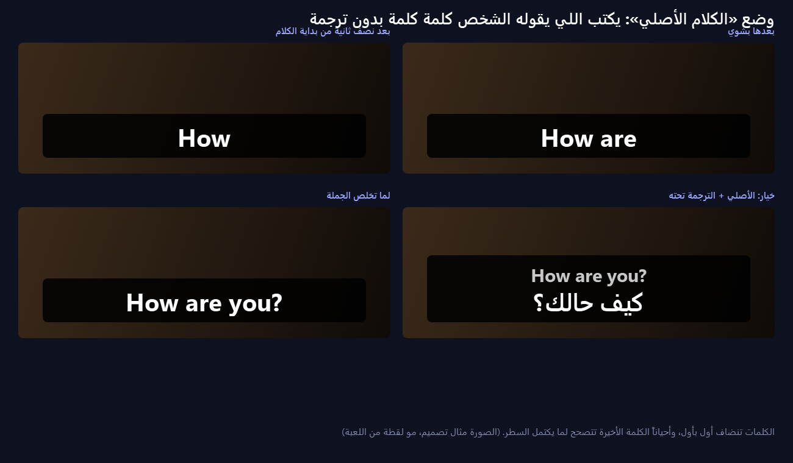

# مترجم Asobi — Asobi Translator

ترجمة فورية إلى العربية لألعاب PS5 عبر تطبيق **Asobi: Remote Play** على الكمبيوتر.
Live Arabic translation overlay for games played through Asobi Remote Play on Windows.

- يسمع صوت اللعبة فقط (التقاط صوت عملية Asobi) ويترجم الحوار أثناء الكلام.
- يقرأ نص الشاشة (OCR) ويترجمه.
- نافذة الترجمة تظهر في Discord وOBS والتسجيل.
- يختار نماذج السماع والترجمة تلقائياً حسب ذاكرة كرت الشاشة (NVIDIA).
- لا يعدّل Asobi ولا يتجاوز أي حماية.

## التثبيت / Install
نزّل `AsobiTranslator-Setup.exe` من صفحة [Releases](../../releases/latest) وشغّله.
المثبّت يجهّز بايثون والمكتبات والنماذج المناسبة لكرتك (التنزيل بين 5 و22 جيجا أول مرة).
التحديثات تنزل من داخل البرنامج (صفحة «التحديثات»).

## المتطلبات / Requirements
- Windows 10/11، إنترنت أول تثبيت
- كرت NVIDIA موصى به (أي ذاكرة، والبرنامج يختار الجودة المناسبة)، بدونه يشتغل على المعالج ببطء

## البناء / Build
```
powershell -File installer\build.ps1 -BaseUrl https://github.com/kloody60/asobi-translator/releases/download/vX.Y.Z
```
ينتج `dist\AsobiTranslator-Setup.exe` و zip التحديث و `version.json`.

## التراخيص / Licenses
النماذج: NLLB-200 (Meta) بترخيص CC-BY-NC 4.0 — **للاستخدام غير التجاري فقط**. Whisper (MIT).

## صور البرنامج / Screenshots

| الرئيسية | أثناء الترجمة |
|---|---|
|  |  |

| المظهر والمكان | الإعدادات |
|---|---|
|  |  |

### أوضاع العرض / Display modes
ترجمة عربية، أو الكلام الأصلي كلمة كلمة بدون ترجمة، أو الاثنين معاً (من الإعدادات المتقدمة، أو Ctrl+Alt+M).


